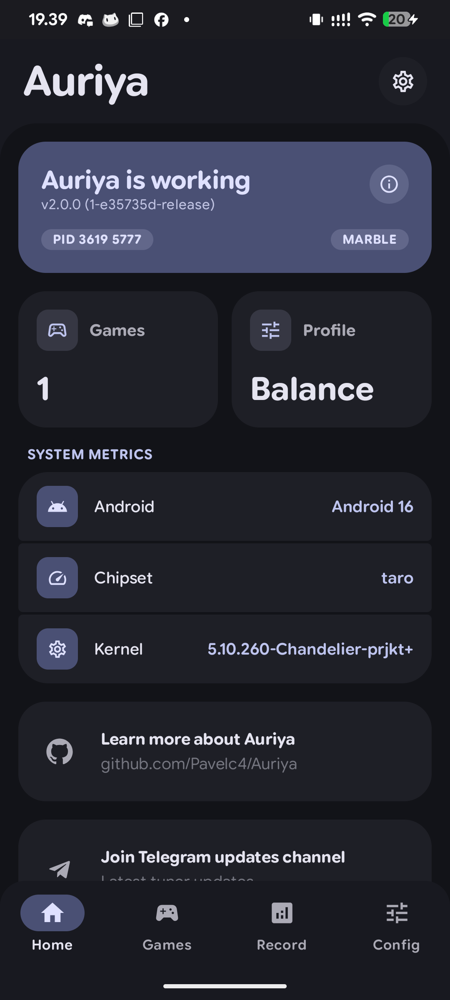
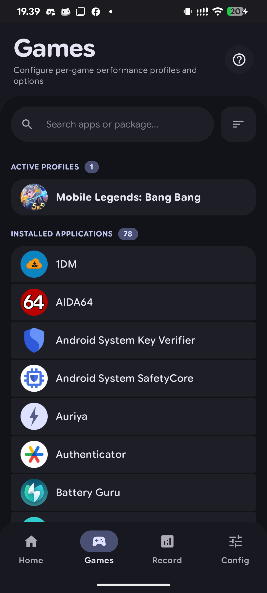
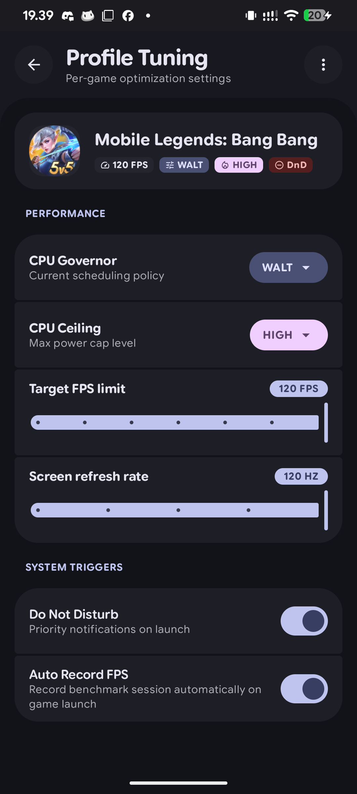
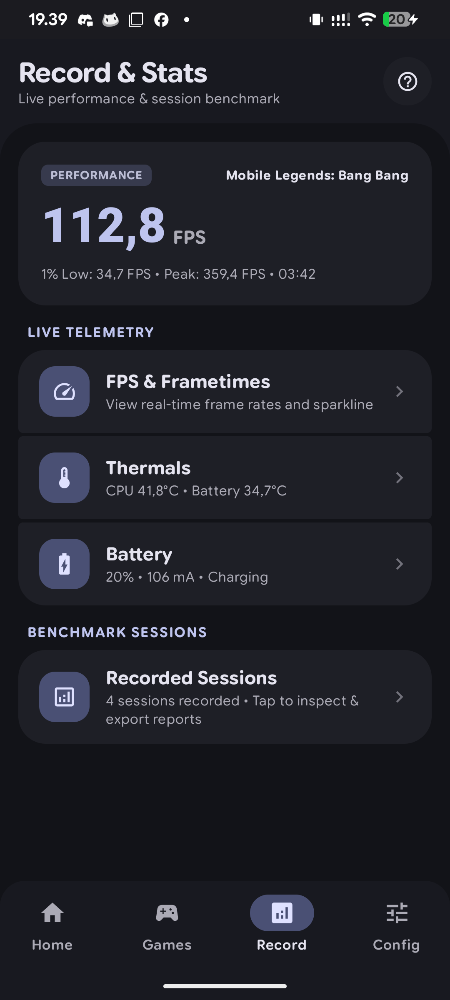
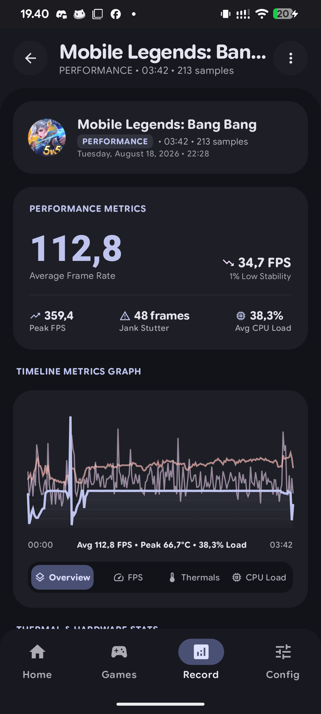
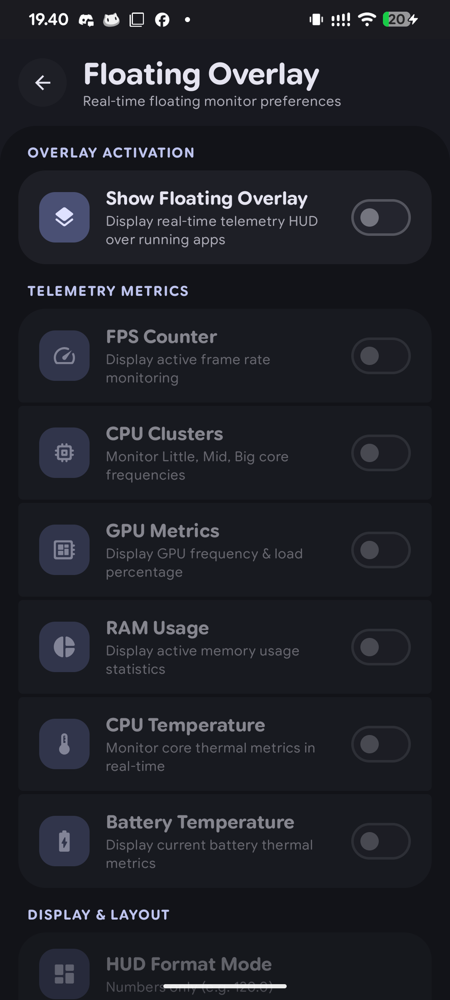
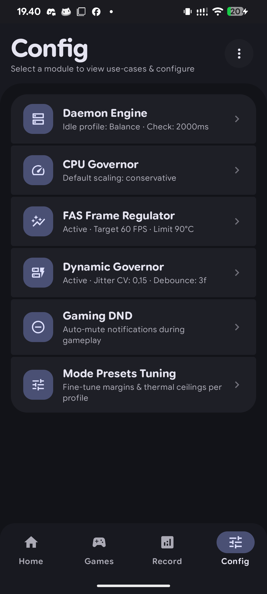
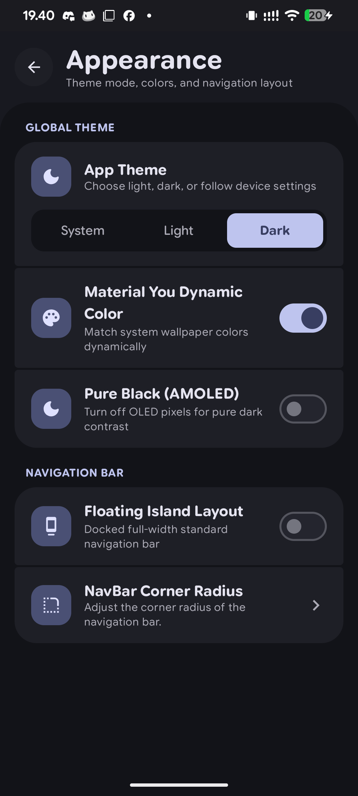
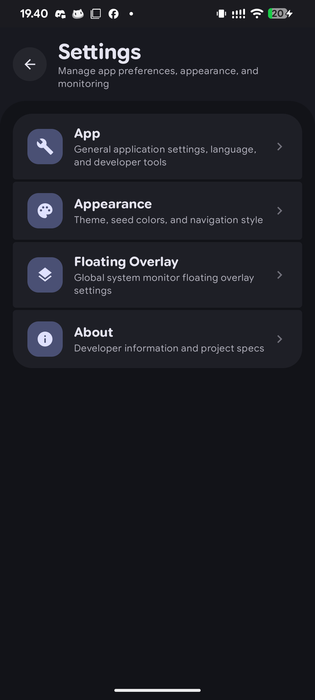

  

  
  
  
  
  

## About Auriya
Auriya is an Android performance optimization daemon written in Rust, with a Jetpack Compose manager app and native Binder IPC.

Documentation is available at [auriya.pages.dev](https://auriya.pages.dev).

> [!NOTE]
> This module is an experimental project for rooted devices. Features and tuning behaviors may change between releases.

## Features
- Native Rust daemon for system tuning and profile management
- Dynamic frame-aware scheduling based on real-time frametimes
- Per-game profiles for target FPS, refresh rates, and automated Do Not Disturb
- Telemetry and session recording for FPS, temperature, and battery metrics
- Compose app with an optional floating HUD overlay
- `auriyactl` CLI for terminal monitoring and profile switching

## Screenshots
| Home | Games | Tuning |
| :---: | :---: | :---: |
|  |  |  |

| Telemetry | Benchmark | Floating HUD |
| :---: | :---: | :---: |
|  |  |  |

| Domain Config | Customization | Settings |
| :---: | :---: | :---: |
|  |  |  |

## Documentation
- [auriyactl CLI Reference](doc/auriyactl.md)
- [Installation Guide](https://auriya.pages.dev/getting-started/installation/)
- [Configuration and Profiles](https://auriya.pages.dev/getting-started/configuration/)
- [Telemetry Protocol and FPS Benchmark API](https://auriya.pages.dev/reference/stats-api/)
- [Architecture Overview](https://auriya.pages.dev/architecture/overview/)

## Resources
- [Releases](https://github.com/pavelc4/auriya/releases)
- [Issue Tracker](https://github.com/pavelc4/auriya/issues)

## Translation
Auriya translations are managed on [Crowdin](https://crowdin.com/project/auriya). Contributions for existing and new languages are welcome.

## Support
If you find Auriya useful, consider starring the repository on GitHub.

## License
Auriya is open-source software licensed under [GPLv3](LICENSE).
