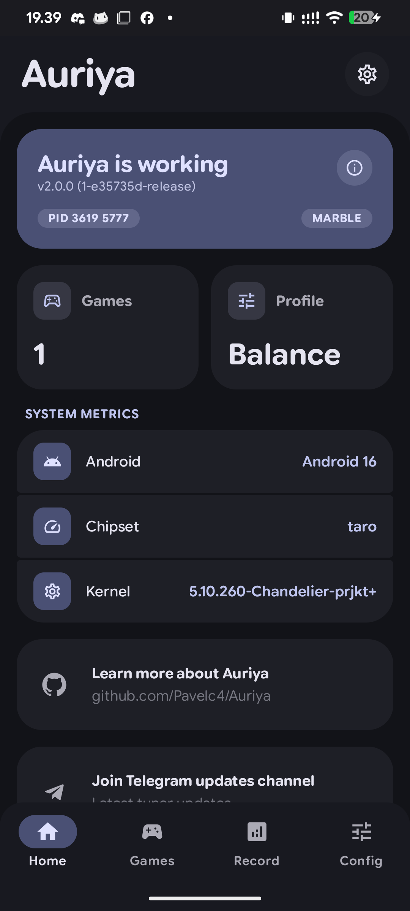
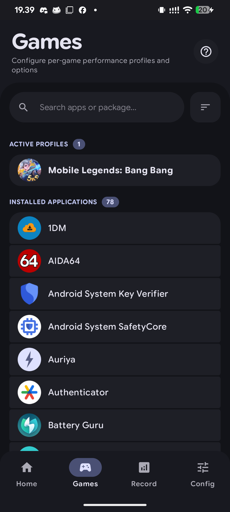
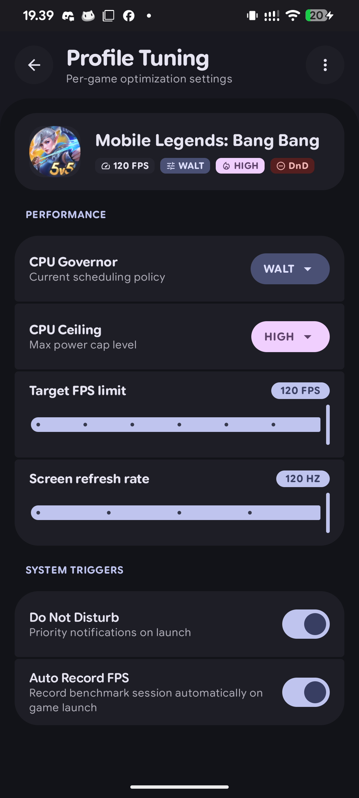
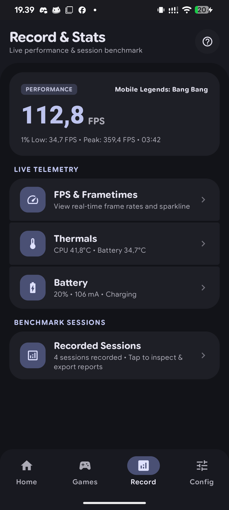
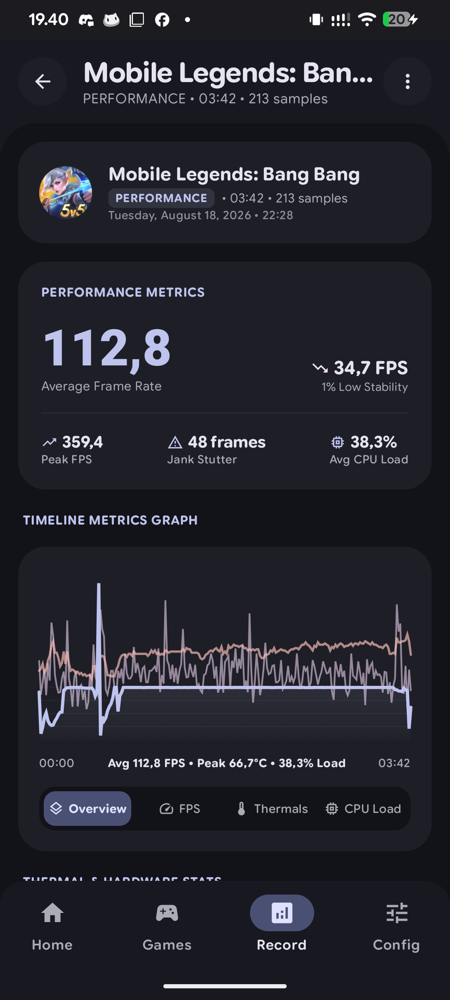
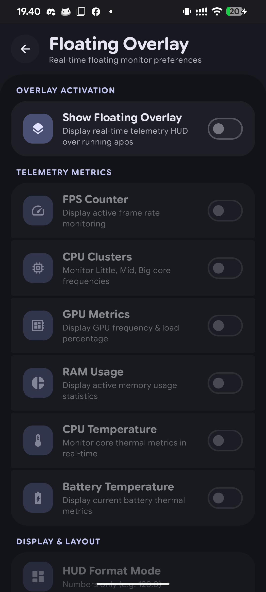
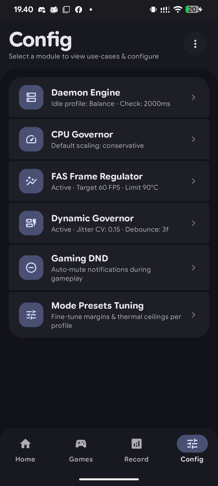
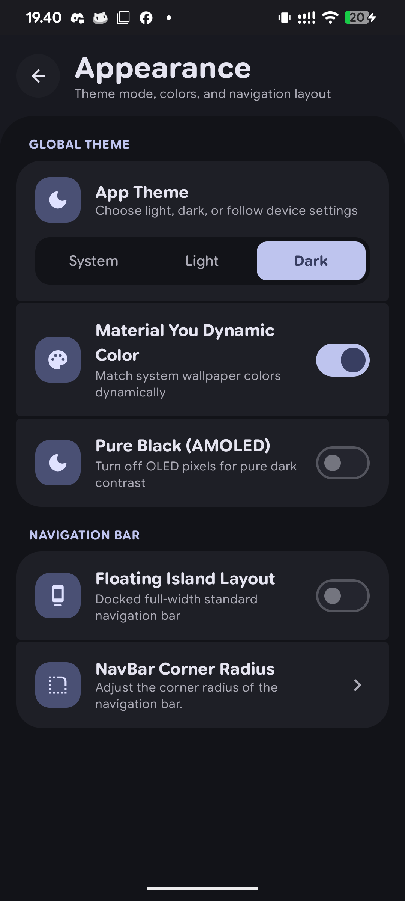
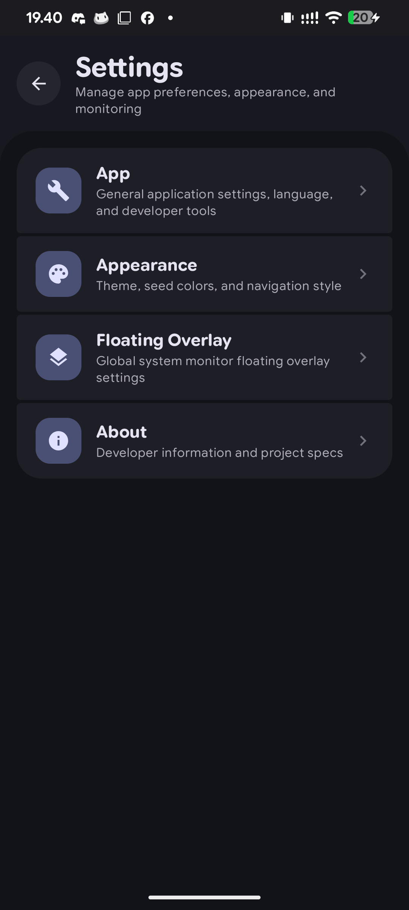

  
  
  
  

## About Auriya
**Auriya** is a rooted Android performance optimization daemon written in Rust, paired with a modern Jetpack Compose manager application and native Binder IPC.

Visit the [Official Documentation](https://auriya.pages.dev) for detailed guides and configuration references.

> [!NOTE]
> **Disclaimer**: This module is an experimental hobbyist project. Features and system tuning behaviors may evolve across releases.

## Features
- **Rust Native Daemon**: Background service handling system tweaks, performance tuning, and profile switching.
- **Dynamic Frame-Aware Scheduling**: Dynamically adjusts CPU frequencies based on real-time frametimes.
- **Per-Game Profiles**: Custom target FPS, refresh rates, CPU modes, and automated Do Not Disturb per application.
- **Live Benchmark and Telemetry**: Real-time FPS, temperature, and battery monitoring with session recording.
- **Manager App and Floating HUD**: Jetpack Compose manager interface and real-time on-screen telemetry overlay.
- **Command-Line Interface (`auriyactl`)**: Terminal utility for status monitoring and profile management.

## Screenshots
| Home | Games | Tuning |
| :---: | :---: | :---: |
|  |  |  |

| Telemetry | Benchmark | Floating HUD |
| :---: | :---: | :---: |
|  |  |  |

| Domain Config | Customization | Settings |
| :---: | :---: | :---: |
|  |  |  |

## Documentation
Detailed guides, architectural references, and API documentation are available:
- [auriyactl CLI Reference](doc/auriyactl.md)
- [Installation Guide](https://auriya.pages.dev/getting-started/installation/)
- [Configuration and Profiles](https://auriya.pages.dev/getting-started/configuration/)
- [Telemetry Protocol and FPS Benchmark API](https://auriya.pages.dev/reference/stats-api/)
- [Architecture Overview](https://auriya.pages.dev/architecture/overview/)

## Supported Root Managers
- [Magisk](https://github.com/topjohnwu/Magisk)
- [KernelSU](https://github.com/tiann/KernelSU)
- [APatch](https://github.com/bmax121/APatch)

## Resources
- [Documentation Website](https://auriya.pages.dev)
- [Releases](https://github.com/pavelc4/auriya/releases) (flashable module ZIP packages)
- [Changelog](CHANGELOG.md) (version history)
- [Issues](https://github.com/pavelc4/auriya/issues) (bug reports and tracking)

## Support
If you find Auriya useful, consider starring the repository on GitHub.

## License
Auriya is open-sourced software licensed under the [GNU General Public License v3.0](LICENSE).
